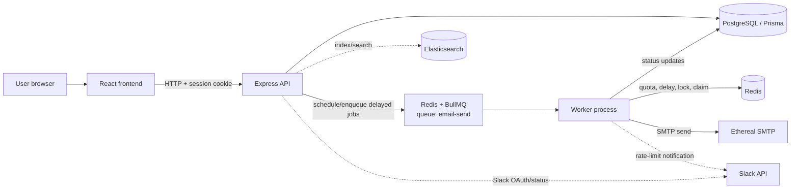

# PULSE Email Scheduler

PULSE is a web application for scheduling and delivering emails through a background worker pipeline. Users authenticate with Google, manage senders, compose and schedule email batches, and review scheduled and sent messages from a dashboard.

The project addresses the operational parts of delayed email delivery that are difficult to handle reliably inside a single request/response flow: durable job scheduling, restart recovery, per-sender quota enforcement, send pacing across workers, and delivery/status tracking. It was implemented for the ReachInbox hiring assignment using Node.js/TypeScript, PostgreSQL/Prisma, Redis/BullMQ, Ethereal SMTP, Elasticsearch, React/Vite, Google OAuth, and Slack.

## Technology stack

### Frontend
- React 19 (`react`, `react-dom`)
- TypeScript
- Vite 8 (`@vitejs/plugin-react`)
- React Router 7
- Tailwind CSS 3 + PostCSS + Autoprefixer
- `lucide-react` icons
- `oxlint` (lint script)

### Backend
- Node.js / TypeScript (ES modules)
- Express 5
- `express-session` with `connect-redis` (Redis-backed sessions)
- Prisma ORM (`@prisma/client`, `prisma` 6.x)
- `cors`, `dotenv`

### Database
- PostgreSQL 16 (Docker Compose service `postgres`)

### Queue and background processing
- Redis 7 with AOF enabled (Docker Compose service `redis`)
- BullMQ queue `email-send`
- `ioredis`
- Bull Board (`@bull-board/api`, `@bull-board/express`) for queue inspection

### Search
- Elasticsearch 8.15 (Docker Compose service `elasticsearch`, single-node, security disabled for local development)
- `@elastic/elasticsearch`

### Authentication
- Google OAuth 2.0 (server-side exchange in backend)
- Cookie-based sessions (`pulse.sid`, `httpOnly`, `sameSite=lax`)

### Email delivery
- Nodemailer
- Ethereal Email SMTP (test delivery and preview URLs)

### Notifications
- Slack OAuth v2 and Slack Web API (`@slack/web-api`) for rate-limit notifications

## Project structure

```text
pulse-email-scheduler/
|-- backend/
|   |-- prisma/
|   |   |-- migrations/                # Prisma migrations
|   |   `-- schema.prisma              # PostgreSQL schema (User, Sender, Email, SlackAccount)
|   |-- src/
|   |   |-- config/                    # Prisma, Redis/ioredis, Elasticsearch clients
|   |   |-- middleware/                # Session auth and Bull Board basic auth
|   |   |-- queue/                     # BullMQ queue, worker, reconcile, rate limit, lock, throttle
|   |   |-- routes/                    # Express route modules (auth, emails, senders, dashboard, slack)
|   |   |-- services/                  # Google OAuth, mail, search/indexing, Slack
|   |   |-- types/                     # Express session typings
|   |   |-- utils/                     # HTTP/validation helpers
|   |   `-- server.ts                  # Express API entrypoint
|   |-- .env.example
|   |-- package.json
|   `-- tsconfig.json
|-- frontend/
|   |-- public/                        # Static assets (favicon/icons)
|   |-- src/
|   |   |-- components/                # Reusable UI components
|   |   |-- hooks/                     # Auth context/hook
|   |   |-- layouts/                   # Dashboard layout/shell
|   |   |-- pages/                     # Login, Dashboard, Scheduled, Sent, Compose, Email detail
|   |   |-- services/                  # API client (`VITE_API_URL`, credentials included)
|   |   |-- types/                     # Shared frontend types
|   |   |-- utils/                     # CSV/text recipient parsing
|   |   |-- App.tsx                    # Routes
|   |   `-- main.tsx
|   |-- .env.example
|   |-- package.json
|   `-- vite.config.ts
|-- docs/
|   |-- DEMO_SCRIPT.md                 # Demo walkthrough (if included in the repository)
|   `-- GITHUB_SUBMISSION_CHECKLIST.md # Submission checklist (if included in the repository)
|-- docker-compose.yml                 # PostgreSQL, Redis (AOF), Elasticsearch
|-- .gitignore
`-- README.md
```

## Prerequisites

- Node.js 20+ recommended (backend/frontend tested in environments using Node 22.x; no `engines` field is declared in `package.json`).
- npm (lockfiles are present: `backend/package-lock.json`, `frontend/package-lock.json`).
- Docker Desktop with Docker Compose v2.
- PostgreSQL, Redis, and Elasticsearch for local infrastructure. The repository provides `docker-compose.yml` to start all three.
- Google OAuth credentials (client ID/secret and callback URL) for real login.
- An Ethereal Email test account for SMTP testing.
- Slack app credentials if Slack OAuth/rate-limit notifications are to be tested.

## Environment configuration

Use the existing templates:
- `backend/.env.example`
- `frontend/.env.example`

Create local environment files (do not commit `.env` files):

```powershell
Copy-Item backend\.env.example backend\.env
Copy-Item frontend\.env.example frontend\.env
```

Edit the local `.env` files with real values. Never commit secrets or place credentials in source code, README, screenshots, or logs.

### Backend variables (`backend/.env.example`)

| Variable | Purpose |
|---|---|
| `PORT` | Express API port (default `3000`). |
| `NODE_ENV` | Runtime environment (`development`/`production`). Production refuses weak/missing `SESSION_SECRET`. |
| `FRONTEND_URL` | Allowed CORS origin and OAuth redirect target base URL. |
| `DATABASE_URL` | PostgreSQL connection string used by Prisma. |
| `REDIS_URL` | Redis connection string used by BullMQ, rate limiting, throttling, locks, and sessions. |
| `ELASTICSEARCH_URL` | Elasticsearch node URL. |
| `WORKER_CONCURRENCY` | BullMQ worker concurrency (default in code falls back to `5` if unset/invalid). |
| `MIN_DELAY_BETWEEN_EMAILS_MS` | Environment fallback/global minimum delay between sends (ms). `sendDelayMs` specifies the requested per-email delay. The worker enforces the effective delay as the maximum of the configured global minimum and the email-specific delay, coordinating sends through a shared Redis throttle. |
| `MAX_EMAILS_PER_HOUR_PER_SENDER` | Environment fallback sender hourly limit; `Sender.hourlyLimit` overrides per sender. |
| `ETHEREAL_SMTP_HOST` | Ethereal SMTP host (template uses `smtp.ethereal.email`). |
| `ETHEREAL_SMTP_PORT` | Ethereal SMTP port (template uses `587`). |
| `ETHEREAL_SMTP_USER` | Ethereal SMTP username. |
| `ETHEREAL_SMTP_PASS` | Ethereal SMTP password. |
| `GOOGLE_CLIENT_ID` | Google OAuth client ID. |
| `GOOGLE_CLIENT_SECRET` | Google OAuth client secret. |
| `GOOGLE_CALLBACK_URL` | Google OAuth callback URL registered with Google (template: `http://localhost:3000/api/auth/google/callback`). |
| `SESSION_SECRET` | Session signing secret. Use a strong random value outside local experiments. |
| `BULL_BOARD_USER` | HTTP Basic Auth username for `/admin/queues`. |
| `BULL_BOARD_PASS` | HTTP Basic Auth password for `/admin/queues`. |
| `SLACK_CLIENT_ID` | Slack OAuth client ID. |
| `SLACK_CLIENT_SECRET` | Slack OAuth client secret. |
| `SLACK_REDIRECT_URI` | Slack OAuth redirect URI (template: `http://localhost:3000/api/slack/callback`). |
| `SLACK_DEFAULT_CHANNEL_ID` | Optional default Slack channel ID used by `sendSlackMessage` when an account has no `channelId`. |

Operational note: `backend/src/server.ts` also supports `EXPOSE_QUEUE_STATS=true` to expose `/api/queue/stats` in production (otherwise production returns 404 for that endpoint while still requiring auth in code). This is not listed in `.env.example`.

### OAuth setup

To run the Google and Slack integrations locally, the provider configuration must match the backend callback URLs and frontend origin:

- **Google Cloud Console:** configure an OAuth client with an authorized redirect URI that exactly matches `GOOGLE_CALLBACK_URL` (template: `http://localhost:3000/api/auth/google/callback`). Ensure the frontend origin used by the app is allowed by your local CORS/app configuration (`FRONTEND_URL`).
- **Slack app:** configure the OAuth redirect URL to match `SLACK_REDIRECT_URI` (template: `http://localhost:3000/api/slack/callback`). The Slack app must have the permissions/scopes required to send messages to the selected channel (the implementation requests chat and channel-reading scopes; see `backend/src/services/slack.ts`). If a connected Slack account does not have `channelId` set, `SLACK_DEFAULT_CHANNEL_ID` can be used as the default notification channel.

### Frontend variables (`frontend/.env.example`)

| Variable | Purpose |
|---|---|
| `VITE_API_URL` | Base URL for backend API calls (template: `http://localhost:3000`). |

## Ethereal Email setup

Ethereal is a test SMTP service. Messages sent through Ethereal are not delivered to real-world recipient inboxes; Ethereal provides preview URLs for inspection.

1. Open https://ethereal.email/ and create a test account.
2. Copy the SMTP host, port, username, and password from the account details.
3. Set `ETHEREAL_SMTP_HOST`, `ETHEREAL_SMTP_PORT`, `ETHEREAL_SMTP_USER`, and `ETHEREAL_SMTP_PASS` in `backend/.env`.
4. Start PostgreSQL/Redis/Elasticsearch, the backend API, and the worker.
5. Sign in, select/create a sender as needed, compose an email, and schedule it.
6. When the worker sends the email, the application stores the Ethereal preview URL on the email record (when available). Use that preview URL to inspect the test message in Ethereal.

The mail service can create a temporary Ethereal account in some local/dev configurations when SMTP variables are not fully configured; check API/worker logs for preview behavior. Do not treat preview delivery as proof of real inbox delivery.

## Running the backend

All commands below are PowerShell and use scripts/configuration present in the repository.

```powershell
# From repository root
docker compose up -d
docker compose ps
```

```powershell
# Backend setup
cd backend
npm install
Copy-Item .env.example .env
# Edit backend\.env with local values. Keep secrets out of source control.

npx prisma generate
npx prisma migrate deploy
# For local schema development only (when appropriate): npx prisma migrate dev

npm run dev
```

Start the BullMQ worker in a separate terminal (the API and worker must both run for scheduled delivery):

```powershell
cd backend
npm run worker
# Equivalent watch script also exists: npm run dev:worker
```

Useful backend scripts (`backend/package.json`):

```powershell
cd backend
npm run typecheck      # tsc --noEmit
npm run build          # tsc
npm run start          # node dist/server.js
npm run start:worker   # node dist/queue/emailWorker.js
```

Prisma validation (run from `backend` so it uses the local Prisma version):

```powershell
cd backend
npx prisma validate
```

The API listens on `http://localhost:3000` by default (`PORT=3000`). On startup it runs a non-fatal reconcile pass to ensure pending `SCHEDULED`/`RATE_LIMITED` emails have BullMQ jobs.

## Running the frontend

```powershell
cd frontend
npm install
Copy-Item .env.example .env
# Set VITE_API_URL if needed (default template: http://localhost:3000)

npm run dev
```

Vite’s default local URL is typically `http://localhost:5173` unless configured otherwise; use the URL reported by Vite in the terminal. `frontend/vite.config.ts` does not set a custom port, and backend CORS defaults to `http://localhost:5173` unless `FRONTEND_URL` is changed.

Production build and preview:

```powershell
cd frontend
npm run build          # tsc -b && vite build
npm run preview
```

Lint script (configured):

```powershell
cd frontend
npm run lint           # oxlint
```

## Architecture overview



Notes:
- Elasticsearch indexing is performed by the search service (index-by-email-id calls after scheduling and from worker paths where implemented); search/indexing failures are handled as non-fatal in relevant paths.
- Slack notifications are used for rate-limit events and depend on Slack configuration/connected account behavior.

### Scheduling workflow

1. The user signs in with Google (session cookie created by backend).
2. The frontend sends `POST /api/emails/schedule` with sender, recipients, subject, body, scheduled time, and optional batch `sendDelayMs`.
3. The API authenticates the session, validates input, and confirms the sender is active and owned by the authenticated user.
4. Email rows are created in PostgreSQL with status `SCHEDULED` and a unique `idempotencyKey`. `sendDelayMs` is persisted per email (request value or environment fallback resolved at creation).
5. For created rows, the API enqueues BullMQ delayed jobs (`jobId = email-<id>`) and stores `bullJobId` when possible.
6. The worker processes due jobs: it checks idempotent quota reservation, applies global send throttling, acquires a Redis lock, performs a conditional DB claim (`SCHEDULED|RATE_LIMITED -> PROCESSING`), sends through Nodemailer/Ethereal, and updates status/timestamps/preview URL.
7. Search indexing is attempted after DB/enqueue (and worker paths as implemented); indexing failures do not replace the primary scheduling/send state machine.

### Persistence and restart recovery

- PostgreSQL is the source of truth for users, senders, emails, and Slack account records.
- Redis stores BullMQ job state (with AOF enabled in Docker Compose), session data, rate-limit keys/reservations, locks, and throttle state.
- Delayed jobs can survive API/worker process restarts when Redis/PostgreSQL data is retained.
- On API startup, `reconcilePendingEmailJobs()` scans pending `SCHEDULED`/`RATE_LIMITED` emails and enqueues/ensures jobs as needed (non-fatal on startup error). The current implementation loads pending rows without pagination.
- Stable job IDs (`email-<id>`), DB status checks/claims, idempotency keys, and Redis locks reduce duplicate processing risk. This does not guarantee exactly-once SMTP delivery across a crash between provider acceptance and the final `SENT` DB commit.

### Rate limiting

- Effective hourly limit per sender: `Sender.hourlyLimit` when set, otherwise `MAX_EMAILS_PER_HOUR_PER_SENDER`.
- Worker enforces quota using Redis atomic, per-email idempotent reservation logic in UTC hour buckets.
- When quota is exceeded, the email is marked/rescheduled as `RATE_LIMITED` and delayed (not marked `FAILED` for quota exhaustion).
- Slack rate-limit notification is attempted as a non-fatal path with Redis deduplication.

### Minimum delay and concurrency

- `MIN_DELAY_BETWEEN_EMAILS_MS` is the environment fallback. Schedule requests may provide `sendDelayMs` (persisted per email).
- `sendDelayMs` specifies the requested per-email delay. The worker enforces the effective delay as the maximum of the configured global minimum (`MIN_DELAY_BETWEEN_EMAILS_MS`) and the email-specific delay, coordinating sends through a shared Redis throttle. Batches do not get independent parallel send timelines.
- `WORKER_CONCURRENCY` controls BullMQ worker concurrency. Safety mechanisms include Redis send locks, conditional DB claims, status/idempotency guards, stable job IDs, and delayed-job deferral (`DelayedError`/`moveToDelayed`) for claim/rate-limit/delay paths.
- The implementation is designed to avoid intentionally sending the same job twice, but it is not documented here as strict exactly-once SMTP delivery.

## Implemented features mapped to the assignment

Status labels: **Implemented (verified in code)**, **Implemented (runtime evidence partial)**, **PARTIAL**, **NOT TESTED**.

### Backend

| Assignment requirement | Implementation | Status / evidence note |
|---|---|---|
| Email scheduling API | `POST /api/emails/schedule` (`backend/src/routes/emails.ts`) | Implemented; runtime scheduling/idempotency/load evidence recorded in prior verification sessions (partial overall). |
| Database persistence | PostgreSQL + Prisma models (`User`, `Sender`, `Email`, `SlackAccount`) | Implemented; Prisma schema valid. |
| Background scheduling | BullMQ delayed jobs, queue `email-send` (`backend/src/queue/*`) | Implemented; runtime evidence recorded previously. |
| Restart recovery | `reconcilePendingEmailJobs()` on startup + Redis/DB persistence | Implemented; small-scale restart recovery evidenced previously; 1,000 delayed-job controlled restart not run. |
| Multiple senders | Sender CRUD-ish APIs (`GET/POST/PATCH /api/senders`) with user ownership checks | Implemented. |
| Email delivery | Nodemailer/Ethereal (`backend/src/services/mail.ts`) | Implemented; controlled Ethereal delivery evidenced previously. |
| Hourly rate limiting | Redis-backed atomic per-sender quota + `RATE_LIMITED` reschedule | Implemented; clean quota behavior evidenced previously. Slack live notification remains a separate evidence gap. |
| Minimum send delay | Global Redis throttle + persisted `sendDelayMs`/env fallback | Implemented; contention fix applied earlier; tight 2s boundary proof remains partial. |
| Worker concurrency | Configurable `WORKER_CONCURRENCY`; lock/claim/throttle controls | Implemented; 2-worker contention repro fixed and evidenced previously. |
| Duplicate protection | Unique `idempotencyKey`, stable `email-<id>` job IDs, DB claims/locks | Implemented; same-`scheduledAt` idempotency evidenced previously. |
| Email search | Elasticsearch index/search (`backend/src/services/search.ts`, `/api/emails/search`) | Implemented; ES query and P11 Phase 2 A/B isolation evidenced previously. |
| Queue monitoring | Bull Board `/admin/queues` with basic auth; `/api/queue/stats` (auth; restricted in production) | Implemented; live security/exposure in target environment not fully verified. |
| Slack integration | OAuth connect/callback/status/disconnect + rate-limit notification path | PARTIAL: code/routes exist; real OAuth connect, live hourly-limit Slack message, disconnect/reconnect runtime evidence not fully captured; 2-account isolation not tested. |

### Frontend

| Assignment requirement | Implementation | Status / evidence note |
|---|---|---|
| Google authentication | Login page triggers backend Google OAuth; `/api/auth/me`, callback/session handling | Implemented; user reported 2-profile browser/OAuth verification (manual evidence). |
| User dashboard | `DashboardPage`, stats/sender usage endpoints | Implemented; browser isolation reported by user. |
| Scheduled emails | `ScheduledPage`, `GET /api/emails/scheduled` | Implemented. |
| Sent emails | `SentPage`, `GET /api/emails/sent` | Implemented. |
| Compose email | `ComposePage` (route `/compose`) | Implemented/PARTIAL UI gaps: rich-text formatting and attachment upload are not fully wired; compose-page hourly-limit save is not wired in `ComposePage`. |
| Multiple recipients | CSV/text parsing (`frontend/src/utils/csv.ts`) used by compose flow | Implemented in code; browser/Figma flow not fully verified. |
| Scheduling controls | Scheduled start time and batch `sendDelayMs`; sender hourly limit managed via sender APIs/UI patterns | PARTIAL: start time/delay present; sender hourly-limit editing is available in API/sender flows; compose-page parity may be incomplete. |
| Sender management | Sender API + dashboard/sender-related UI | Implemented (API verified in prior sessions). |
| Slack connection | `SlackConnectionCard` and `/api/slack/*` integration | PARTIAL runtime evidence. |
| Loading and error states | Present in auth/pages/components (e.g., login, dashboard, compose, sent/scheduled/detail) | Implemented (code-level); not exhaustively browser-verified. |

## API overview

Actual route registration is in `backend/src/server.ts` and route files under `backend/src/routes/*`. Request/response shapes should be confirmed from source before integration changes.

### Public/operational
| Method | Path | Notes |
|---|---|---|
| `GET` | `/api/health` | Service health. |
| `GET` | `/admin/queues` | Bull Board UI; protected by HTTP Basic Auth (`bullBoardBasicAuth`). |

### Authentication (`/api/auth`)
| Method | Path | Notes |
|---|---|---|
| `GET` | `/api/auth/me` | Returns current session/auth state. |
| `GET` | `/api/auth/google` | Starts Google OAuth (`redirect=1` redirects to provider). |
| `GET` | `/api/auth/google/callback` | OAuth callback; establishes session and redirects to frontend. |
| `POST` | `/api/auth/logout` | Destroys session and clears `pulse.sid`. |

### Emails (`/api/emails`, authenticated)
| Method | Path | Notes |
|---|---|---|
| `POST` | `/api/emails/schedule` | Schedules email(s); validates sender ownership; supports idempotency and optional batch `sendDelayMs`. |
| `GET` | `/api/emails/scheduled` | Lists `SCHEDULED`, `PROCESSING`, `RATE_LIMITED` for the authenticated user. |
| `GET` | `/api/emails/sent` | Lists `SENT`, `FAILED` for the authenticated user. |
| `GET` | `/api/emails/search?q=` | User-scoped Elasticsearch-backed search. |
| `GET` | `/api/emails/:id` | Fetches one email owned by the authenticated user. |

### Senders (`/api/senders`, authenticated)
| Method | Path | Notes |
|---|---|---|
| `GET` | `/api/senders` | Lists active senders for the authenticated user. |
| `POST` | `/api/senders` | Creates a sender; accepts optional `hourlyLimit`. |
| `PATCH` | `/api/senders/:id` | Updates sender name and/or `hourlyLimit` (ownership-checked). |

### Dashboard (`/api/dashboard`, authenticated)
| Method | Path | Notes |
|---|---|---|
| `GET` | `/api/dashboard/stats` | Dashboard statistics for the authenticated user. |
| `GET` | `/api/dashboard/senders/usage` | Sender usage information. |

### Slack (`/api/slack`)
| Method | Path | Notes |
|---|---|---|
| `GET` | `/api/slack/status` | Auth required; returns Slack connection status. |
| `GET` | `/api/slack/connect` | Auth required; starts Slack OAuth. |
| `GET` | `/api/slack/callback` | Slack OAuth callback. |
| `DELETE` | `/api/slack/disconnect` | Auth required; disconnects Slack account. |

### Queue stats
| Method | Path | Notes |
|---|---|---|
| `GET` | `/api/queue/stats` | Auth required. Returns global BullMQ counts; production returns 404 unless `EXPOSE_QUEUE_STATS=true`. |

## Configuration and operational notes

- **Worker concurrency:** set `WORKER_CONCURRENCY` in `backend/.env`. The worker defaults to `5` when unset/invalid.
- **Minimum delay:** set `MIN_DELAY_BETWEEN_EMAILS_MS` for the environment/global minimum fallback. Batch schedule requests may persist `sendDelayMs` per email as the requested delay. The worker enforces the effective delay as the maximum of the configured global minimum and the email-specific delay using a shared Redis throttle.
- **Hourly sender limits:** set `MAX_EMAILS_PER_HOUR_PER_SENDER` as fallback. Per-sender overrides can be set via `Sender.hourlyLimit` (sender APIs). Rate-limited jobs are rescheduled as `RATE_LIMITED`, not dropped.
- **BullMQ monitoring:** use `/admin/queues` (Bull Board) with `BULL_BOARD_USER`/`BULL_BOARD_PASS`. Do not expose weak/default credentials.
- **Ethereal previews:** inspect worker/API logs and stored `etherealPreviewUrl` values for sent test emails.
- **Elasticsearch:** local service runs at `http://localhost:9200` by default with security disabled; index is `pulse-emails`.
- **Safe restarts:** restart API and worker as normal processes; do not run destructive commands such as `docker compose down -v`, Redis flush, or volume resets when preserving queue/DB state. Startup reconcile is intended to restore pending jobs after process restarts.

## Verification and testing

This section lists checks with code support and/or previously recorded evidence. It does not claim every path is fully verified.

| Check | Status | Notes |
|---|---|---|
| Backend TypeScript check (`cd backend; npm run typecheck`) | PASS (latest local run) | Passed after targeted P11 risk fixes in this session. |
| Frontend production build (`cd frontend; npm run build`) | PASS (latest local run) | Passed after targeted P11 risk fixes in this session. |
| Prisma validation (`cd backend; npx prisma validate`) | PASS (local run during cleanup) | Schema reported valid. |
| API health/infra checks | PARTIAL | Prior sessions recorded healthy Docker services and API/auth safety checks; not rerun during cleanup. |
| Ethereal controlled delivery | PASS (prior evidence) | Controlled SMTP delivery recorded with preview/status evidence. |
| Hourly rate-limit behavior | PARTIAL | Clean quota/reschedule behavior evidenced previously; live Slack hourly-limit notification remains NOT TESTED. |
| Restart recovery | PARTIAL | Small-scale (e.g., 2/20-job contexts in prior runs) evidenced; 1,000 delayed-job controlled restart not run. |
| Idempotency | PASS (prior evidence, same `scheduledAt`) | Same payload + same `scheduledAt` returned duplicate behavior as recorded. |
| Two-worker concurrency | PASS (prior evidence) | Contention stall fix validated by clean 6/6 SENT repro (isolated). |
| 1,000-job scheduling test | PARTIAL | 1,000 future-dated scheduling/persistence/API response observed; not a 1,000 real-send delivery test. |
| Two-user API isolation | PASS (tested paths, prior evidence) | Authenticated API isolation checks recorded. |
| Elasticsearch A/B isolation (P11 Phase 2) | PASS (method B, prior evidence) | Temp sessions + isolated indexed docs verified no cross-user search/detail leak; test data cleaned. |
| Google OAuth/browser E2E + frontend isolation/session independence (P11 Phase 3/5) | PARTIAL (user-reported manual) | User reported verification in 2 browser profiles; not directly observed by this cleanup run. |
| Slack 2-account isolation (P11 Phase 4) | NOT TESTED | Only one authorized Slack account context was available in prior verification. |
| Tight 2s minimum-delay boundary | PARTIAL | Observed gaps were >= 2s but inflated by Ethereal/processing overhead; not a tight boundary proof. |

Strict exactly-once SMTP delivery is **not** guaranteed. The system uses idempotency keys, stable job IDs, locks, and DB claims to reduce duplicates, but a crash between provider acceptance and final DB/status commit can still create ambiguity.

## Known limitations

- Ethereal Email is used for test delivery; messages are not delivered to real recipient inboxes.
- Exactly-once SMTP delivery cannot be guaranteed across crashes occurring after provider acceptance but before the database update.
- Startup reconciliation currently loads pending email records without pagination.
- The 1,000-email load test validates scheduling and persistence, not the actual delivery of 1,000 emails.
- Minimum-delay verification confirmed that observed send intervals respected the configured minimum, but did not establish exact boundary timing.
- Slack notification behavior was tested in code paths and partial runtime evidence; connection, disconnection, reconnection, and live hourly-limit notification events are not fully verified as complete runtime evidence in this environment. Independent multi-account Slack isolation remains unverified.
- 1,000 delayed-job controlled restart recovery was not run.
- Two-user browser OAuth/E2E and frontend/session-independence checks were reported manually; automated or independently observed browser evidence is not included.
- Slack OAuth access tokens are currently stored in the database; before production use this should be treated as a security limitation and hardened appropriately.
- `ComposePage` supports scheduling; rich-text formatting, attachment upload, and compose-page hourly-limit save are not fully wired.

## Assignment compliance checklist

| ReachInbox requirement area | Status | Notes |
|---|---|---|
| Email scheduling with persistence | Implemented and partially verified | PostgreSQL + BullMQ delayed jobs; runtime evidence exists. |
| Background processing / worker | Implemented and partially verified | Separate worker process, BullMQ consumer. |
| Restart-safe scheduling behavior | Implemented and partially verified | Startup reconcile + persisted infra; 1,000 delayed-job restart not run. |
| Rate limiting per sender/hour | Implemented and partially verified | Redis-backed quota, `RATE_LIMITED` reschedule; live Slack notification not fully evidenced. |
| Minimum delay / throttling with concurrency safety | Implemented and partially verified | Redis throttle + locks/claims; contention fix evidenced; tight boundary partial. |
| Idempotency / duplicate protection | Implemented and partially verified | Unique keys, stable job IDs, conditional claims; SMTP not exactly-once. |
| Google OAuth login | Implemented and partially verified | Code implemented; browser E2E manually reported. |
| Dashboard / scheduled / sent / compose UI | Implemented and partially verified | Routes/components present; full browser/Figma flow not independently verified. |
| Elasticsearch integration | Implemented and partially verified | Index/search implemented; ES A/B isolation PASS (method B). |
| Slack integration | Implemented but partially verified | OAuth/notification paths exist; live notification and 2-account isolation not fully verified. |
| Bull Board / queue monitoring | Implemented and partially verified | Protected UI + stats endpoint; target-environment exposure not fully verified. |
| Two-user isolation | Implemented and partially verified | P10 API paths PASS, P11 ES A/B PASS, browser/session checks manually reported; Slack 2-account not tested. |
| Submission packaging (README, repo, collaborators, demo) | Not verified | This README is updated; private GitHub repo/push, collaborator access, and <=5-minute demo remain outstanding. |
